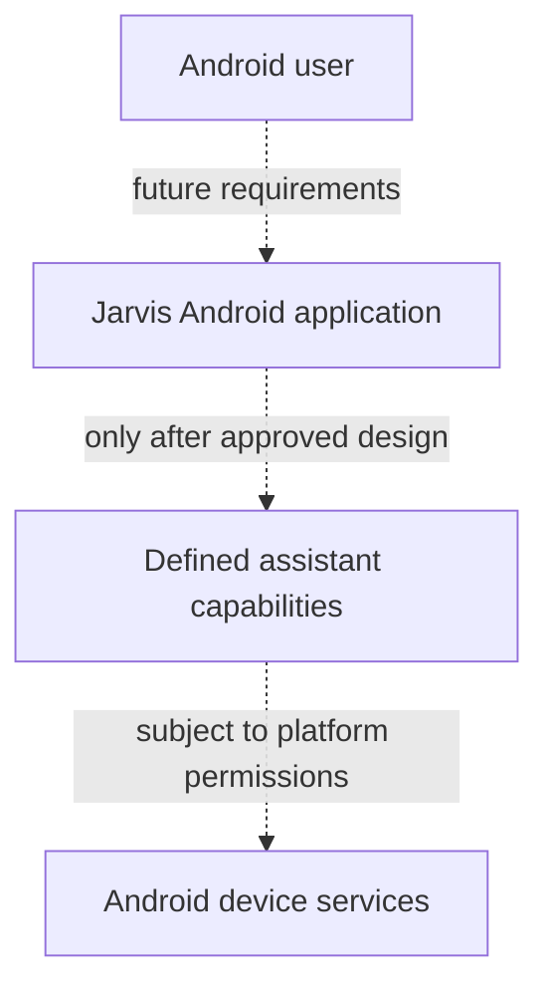

# Jarvis Android

[](#proof-of-concept--enterprise-customization-readiness)
[](#1-project-overview--problem-statement)

**Jarvis Android is currently an empty repository reserved for a future Android-related assistant project.** The default branch contains no tracked application files, source code, dependency manifests, tests, workflows, or deployment configuration.

The repository name suggests an Android assistant direction, but no product specification or technical behavior is documented in the current tree. This README records the verified state and does not claim that an assistant app exists.

## 1. Project Overview & Problem Statement

The repository currently has no implementation or written feature scope. No supported claims can yet be made about voice interaction, AI models, automation, device control, offline operation, permissions, or integrations.

### Conceptual boundary only



This diagram is a placeholder for future product discovery, not an implemented architecture.

## 2. Tech Stack & Versions

No Android SDK, Kotlin/Java version, Gradle version, minimum Android API, framework, model runtime, or third-party dependency has been selected in the current repository tree.

Do not infer a technology stack from the repository name.

## 3. Prerequisites & Dependencies

No application build prerequisites or runtime dependencies are currently defined.

To inspect the repository, Git and access to the GitHub project are sufficient. An Android Studio installation or Android SDK is not currently required because no app source or build configuration is present.

## 4. Installation & Local Setup

Clone the repository:

```bash
git clone https://github.com/zopair/Jarvis-android-.git
cd Jarvis-android-
```

There is currently no Gradle wrapper, Android project, APK, or executable application to build or install.

## 5. Environment Variables

No environment variables, API keys, model paths, service credentials, or Android configuration values are defined.

Do not add private credentials or device identifiers until an approved implementation requires them and a clear local/CI secret-handling approach is documented.

## 6. Usage Guide & Core Features

No executable features are implemented.

Potential future requirements must be specified and approved before implementation, including:
- Supported Android versions and device capabilities.
- Voice input/output and language support.
- On-device versus remote inference boundaries.
- Permission model and user-consent flows.
- Supported assistant actions and confirmation requirements.
- Offline behavior, resource limits, and privacy expectations.

These are planning topics, not current features or commitments.

## 7. Live Demo & Screenshots

No Android application, emulator build, APK, hosted demo, or screenshots are present in the current repository.

## 8. Testing & Verification

No test suite, Gradle build, Android instrumentation tests, CI workflow, static analysis, or release pipeline is present.

A first implementation should introduce a reproducible debug build and a minimal automated test baseline alongside its first runnable feature.

## Proof of Concept & Enterprise Customization Readiness

**Status: Empty repository / concept placeholder.**

| Area | Verified state |
|---|---|
| Tracked source files | None |
| Product requirements | Not documented |
| Android application | None |
| SDK / Gradle configuration | None |
| Dependencies | None |
| Environment configuration | None |
| Tests | None |
| CI / release artifacts | None |
| Live demo | None |
| License | No LICENSE file present in the current tree |

This repository is not yet a PoC or MVP implementation. Before development, define the assistant's first use case, Android permission boundaries, offline/online model strategy, target SDK, and acceptance criteria.

### Change log

- **2026-11-26:** Added the initial repository-state README. No Android source code, build configuration, or runtime behavior was added.

## Intellectual Property & Authorship

Project ownership and requested attribution: **Aly Hussein Zopair (علي حسين زبير ALY HUSSEIN ZOPAIR)**.

This attribution does not create a software license. No LICENSE file is currently present; licensing terms should be selected before external distribution or contributions.
